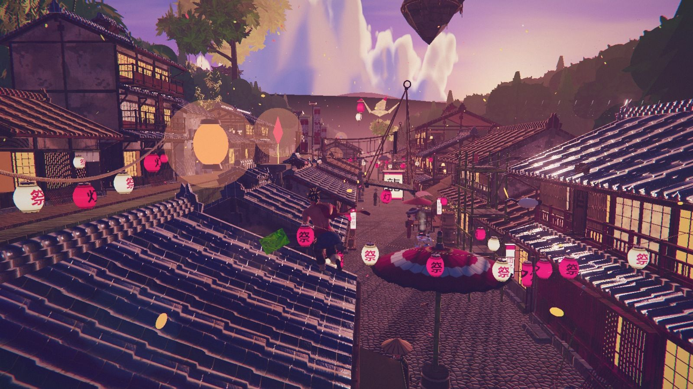

# YŪGURE · 夕暮れ

Parkour por los tejados de una aldea japonesa infinita, medio tragada por la jungla, al atardecer. Una tormenta oscura sale de una compuerta gigante y te persigue: corre, encadena saltos y no toques el suelo.

**▶ Jugar en el navegador:** https://paraderodimicua.github.io/yugure/



## Controles

| Tecla | Acción |
|---|---|
| Flechas / WASD | Moverte en cualquier dirección |
| Espacio | Saltar (mantener = más alto) |
| Clic en el aire | Impulso a cámara lenta hacia el cursor (uno por salto) |
| Contra un borde | Te cuelgas; Espacio justo al agarrarte = salto perfecto |
| Contra un muro en el aire | Espacio = rebote: con W hacia delante, si no hacia donde apuntes |
| Esc | Calidad gráfica: Bajo, Medio, Alto, Ultra |
| P | Foto |

## Qué hay en la alpha 0.3

- Intro con la compuerta gigante y la tormenta saliendo de ella.
- Calle infinita de machiya, vecinos, puestos, farolillos y jungla.
- La tormenta quita vida, acelera con aviso y da «¡Por los pelos!» si escapas rozándola.
- Flujo: sin tocar el suelo de la calle corres más rápido (FLUJO I–V).
- Túneles de torii que cambian de barrio y dan unos segundos de respiro.
- Sombrillas que rebotan, vigas entre casas, andamios, objetos flotantes y columnas del cielo con multiplicador.
- Mejoras permanentes cada 150 m.

En camino: dimensión oscura con portal, dragones y sonido.

## Desarrollo

```bash
npm install
npm run dev      # http://localhost:5183
```

Three.js + TypeScript + Vite. Todo el arte (geometría, texturas, personajes) es procedural y original.
